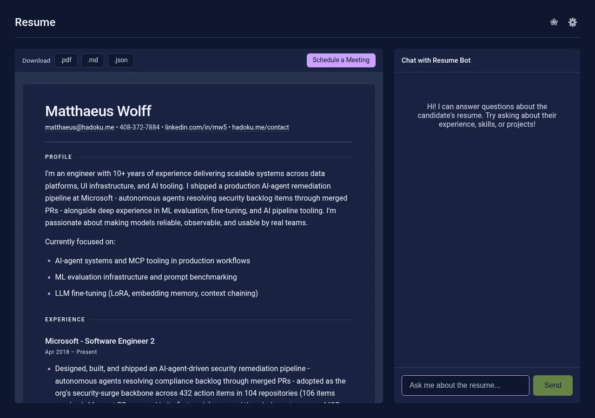

# Resume Bot

Resume Bot is a dual-purpose package: a browser widget that shows a résumé
and lets a visitor chat with an AI about the background behind it, and a
worker API that turns a job description into a tailored résumé and cover
letter on demand. It lives at
[hadoku.me/resume](https://hadoku.me/resume), and the same worker API backs
per-job tailoring for other apps in the hadoku.me family, including
[Job Platform](https://github.com/WolffM/hadoku-jobplatform).

Chatting and reading the résumé need no account. Minting a tailored link,
generating a résumé or cover letter for a specific job, and editing the
résumé's own content all need to be signed in — friend tier and up for
tailoring, admin for editing content.

## Where to read next

| You want to                     | Read                               |
| ------------------------------- | ---------------------------------- |
| use it                          | [features.md](features.md)         |
| run it, change it, or deploy it | [contributing.md](contributing.md) |
| how it got here                 | [history.md](history.md)           |
| the odd facts                   | [trivia.md](trivia.md)             |

## How it fits together

The résumé is not markdown checked into this repo: it is a set of tagged
content blocks held in a Cloudflare KV store, assembled into either the full
résumé or a per-job variant. An LLM picks and lightly rewrites blocks for a
tailored résumé; a deterministic assembler does the rest, so the same
content never has to be retyped for a new job application.

## Trivia

The full list, each with its source, is in [trivia.md](trivia.md).
